# Hero EQ

**A private, iPhone-first AI copilot for product leaders. This page is the case study: the problem, how I decided what to build, what I learned, and how it was built.**

*Formerly PocketPM. Built by [Jamil H. (Hero Minutes)](https://github.com/herominutes). Site: [pocketpm.dev](https://www.pocketpm.dev) (an earlier landing page that still shows the old name; it is being updated).*

> **Status: prototype, not on the App Store.** The app runs on my own iPhone through internal TestFlight builds. I am the only user so far. There are no external testers, no revenue and no usage data, and nothing here claims otherwise. The code is private; this repo holds the thinking, not the code. **TestFlight: internal testing only. External testing TBD.**

**The 60-second version**
- **What:** a private, iPhone-first AI copilot for product leaders. A prototype.
- **Why it is worth a look:** a review found my first build was a platform, not a product, so I cut it from 27 specialists to 12 and cut claims the build could not back.
- **My role:** solo entrepreneur and AI builder, building with Claude Code.
- **Timeline:** the repo's first commit is 18 October 2026, and the most recent work is dated 23 October 2026.
- **What is missing:** real users. No external testers yet; diamond 3 of the design process is next.
- **Try it:** TestFlight, internal testing only. External testing TBD.

---

## The problem

Product leaders make decisions in hallways, on walks between meetings and at whiteboards, then lose the reasoning. Weeks later the decision is re-argued, and the status update takes hours. The AI tools within reach are laptop-first and general-purpose, and many are a poor fit for employer-confidential work: meeting notetakers get banned, and pasting a roadmap into a public chatbot is a risk many leaders will not take.

**Who it is for:** product leaders at software companies. For a first round of testing I narrowed that to heads of product and group PMs at mid-sized companies. Enterprise leaders are a later segment: they have the strictest rules about personal apps and the strongest need for privacy.

## The product in one loop

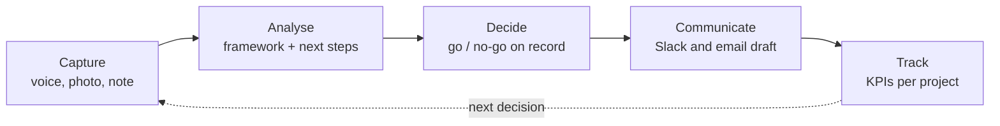

- **Capture** by voice, whiteboard photo, interview recording or text.
- **Ask** three "doors" (strategy and roadmap, business case, communicate) over 12 specialist AI roles.
- **Projects** hold a short brief, KPIs, documents used as context, and updates pulled from Linear and Slack.
- **Launch gates** give a go, conditional go or no-go checklist before a pilot or release.
- **Privacy by design:** data stays on the phone by default, our AI key is never in the app (people can add their own, kept in the Keychain), and documents and pulled updates go to an AI only after the person sees a preview of what will be sent.

### What it looks like

  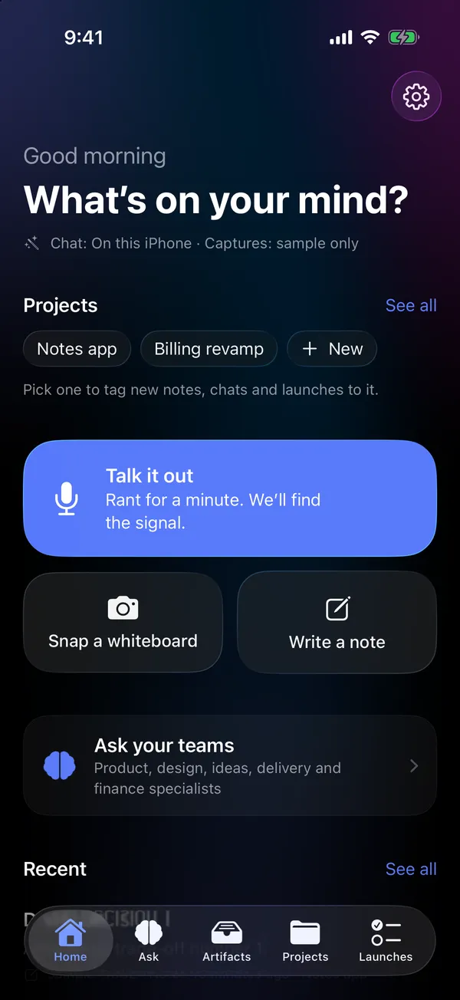
  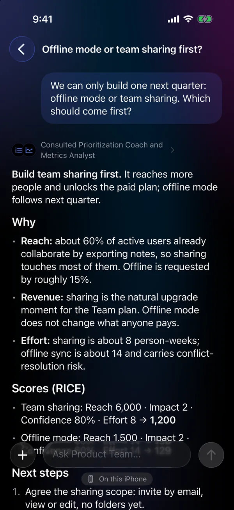
  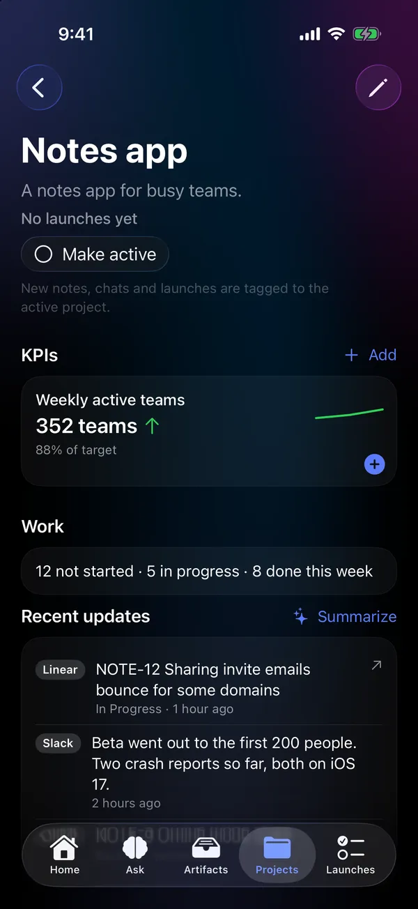

*Screenshots are from an **older build** with made-up demo data (a fictional "Notes app"). The numbers in them are invented to show the layout. They are not results, and no real user data appears.*

## Design approach

I framed the work as a Triple Diamond: the human-centred "double diamond" (problem space, then solution space) plus a third diamond for impact in the real world. Each diamond first opens up options, then narrows to a decision.

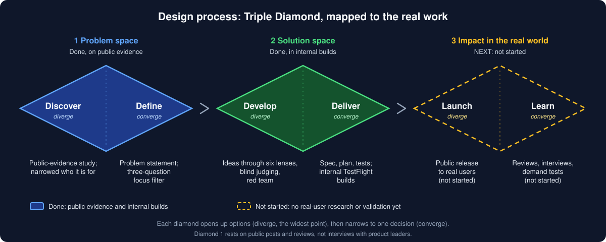

- **Diamonds 1 and 2 are done, with a limit:** the discovery rests on public posts and reviews, not on interviews with product leaders.
- **Diamond 3 has not started.** Real users, reviews, interviews and demand tests are the next step, and until then I make no claim that the product is validated.

## How I decided what to build

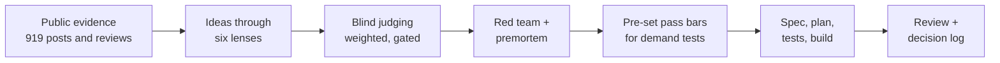

I ran an AI-assisted evidence study before choosing features, and wrote the pass and kill bars for two small demand tests before asking anyone. **Those tests have not been run:** there are no external testers yet.

**What the evidence said, in general terms.** The most common pains were AI product building (evals, prompts, cost), losing decisions and owners after calls, actions dropping between chat and the ticket tool, and PRDs and status updates that take too long. The loudest signal outside features was frustration with price rises and forced AI in note apps, which I took as a pricing lesson, not a feature.

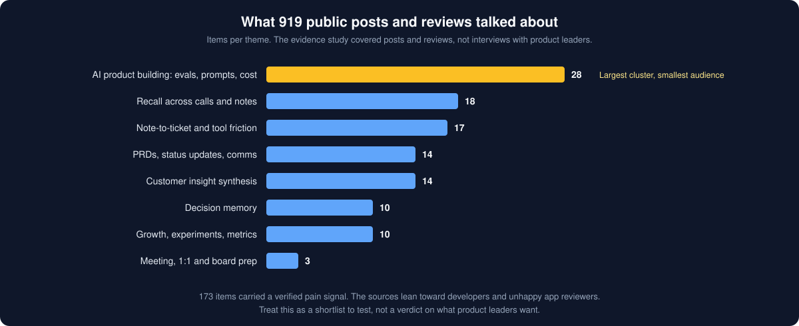

**How far to trust it.** Not far. The evidence leans toward developers and unhappy app reviewers, not product leaders describing a buying decision. No feature cleared the bar as a proven reason to pay, so I treated the ranking as a shortlist to test. There is no user feedback yet, only that research, written reviews of my own plan, and my own testing.

## The focus pass: cutting my own product

A review found the first build was a platform, not a product: 27 specialists, six teams, five tabs and a dozen settings serving one loop. Every feature had to pass three questions.

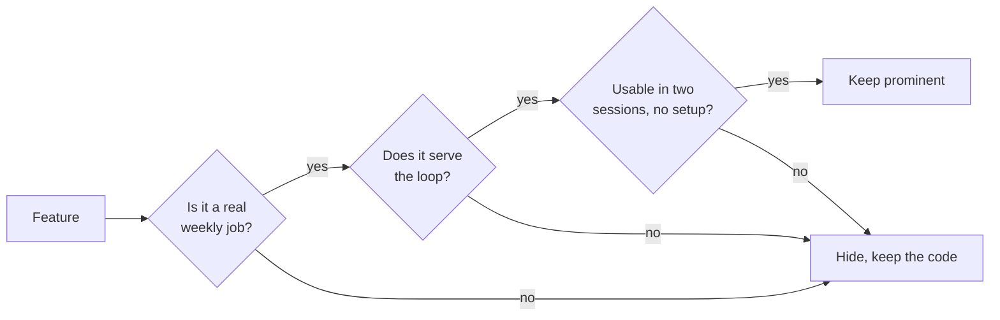

The result: 12 specialists behind three doors and four tabs. Everything else is **hidden, never deleted**, so one setting brings it back if testers ask.

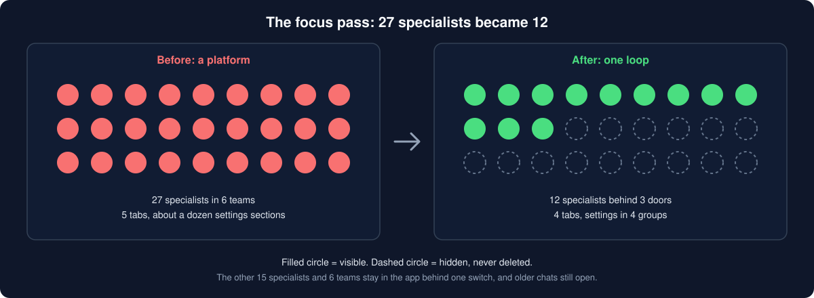

## Strategy

- **Why not just use Claude or ChatGPT?** This is the question that decides everything. The answers I think survive it: it is private and on your phone, it remembers your work across weeks (decisions, launches, KPIs, documents), and it acts (exports, ready-to-send drafts, launch gates). Privacy is strong today; memory and action are partly there. The test is whether each is visible in the first session.
- **Privacy is the positioning, so the copy may claim only what the build does.** That rule cut features. A "ban-proof capture" idea was dropped because the build could not back the claim. A small on-device model invented numbers in testing, so its answers are labelled.
- **Business view:** cost to serve per question is low, the risk is heavy users on a flat plan, and the likely shape is a small subscription business, not a venture-scale one. Prices are still hypotheses and are not published.
- **Measurement:** the app has no analytics by design, which builds trust but blinds me to activation. Fit has to be learned by asking people.

## Privacy at a glance

Privacy is the positioning, so this is the claim in one picture. It describes the current internal build.

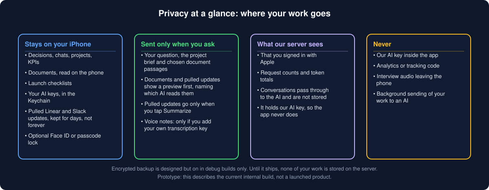

## How it was built

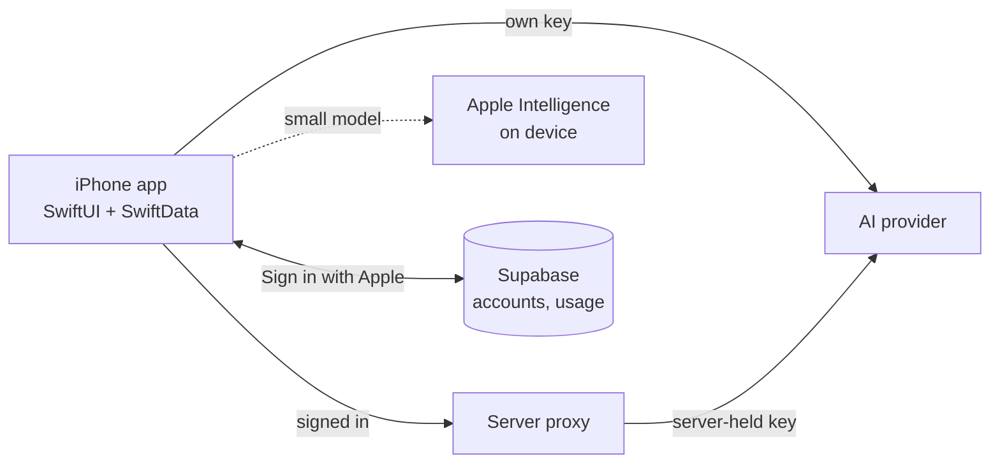

- **Native iOS 26 app** in SwiftUI with on-device storage, a Face ID or passcode lock, and keys in the Keychain. One function decides where an answer is computed, and the on-screen label uses the same function, so a label cannot disagree with what ran.
- **A small proxy** checks the sign-in, applies limits, and forwards to the AI with a key held only on the server. It stores no conversations.
- **Over 1,100 automated tests** (at last count) pin the privacy wording, the "honest numbers" rules for finance answers, and the routing. A security audit was run against the live systems, with findings fixed or logged.
- **Built with Claude Code** in a loop: a short written design, a task plan, code written against tests, an independent review, then an honest changelog that says what was not verified. What did not work: a "remove saved chats" action took three review rounds, each finding a new data-loss case, so I removed the feature rather than patch it a fourth time.

## How it evolved

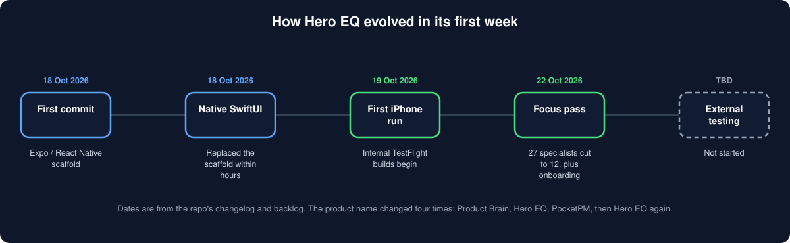

The repo's first commit was an Expo / React Native scaffold, which I replaced with a native SwiftUI iPhone app the same day. The name changed four times along the way: Product Brain, Hero EQ, PocketPM, then Hero EQ again.

## Roadmap and status

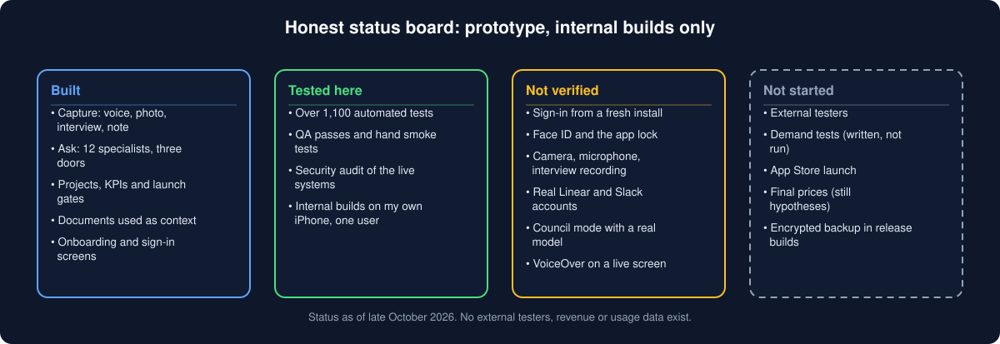

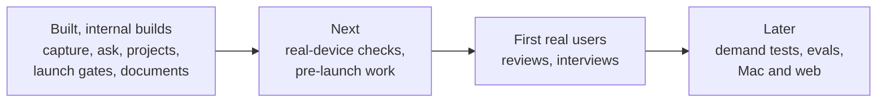

- **Not yet verified:** Sign in with Apple from a fresh install, Face ID and the lock, camera, microphone and interview recording, and real Linear and Slack accounts. A simulator cannot test most of these.
- **Hidden, not deleted:** the other specialists and teams, one pull integration, extra AI providers (behind Advanced), a multi-specialist "council" meeting mode (built, not tried with a real model), and encrypted backup (debug builds only).
- **Cut:** features the build could not back, features free tools already cover, and anything that would weaken the privacy promise, including analytics.
- **Decided against advice:** I chose a public launch with feedback gathered after, not a private fit round first. The consequences are recorded.

## What I learned

1. A broad product is the most expensive way to learn. Narrow to one loop, one segment and one promise.
2. Write the pass and kill bars before asking anyone, and say plainly when a test has not been run.
3. In a privacy product, cutting a claim you cannot back is a feature.
4. State confidence, source bias and what was not checked next to every conclusion.

## What is not here

The app's source code, backend and database design, account and infrastructure details, pricing, real-user data (the three screenshots use made-up demo data; the other images are diagrams I drew), and the raw research data. No testers, users or customers appear in this repo.

*© 2026 Jamil H. (Hero Minutes). Shared for portfolio review; all rights reserved. There is no license file because this repo holds a write-up, not software.*
